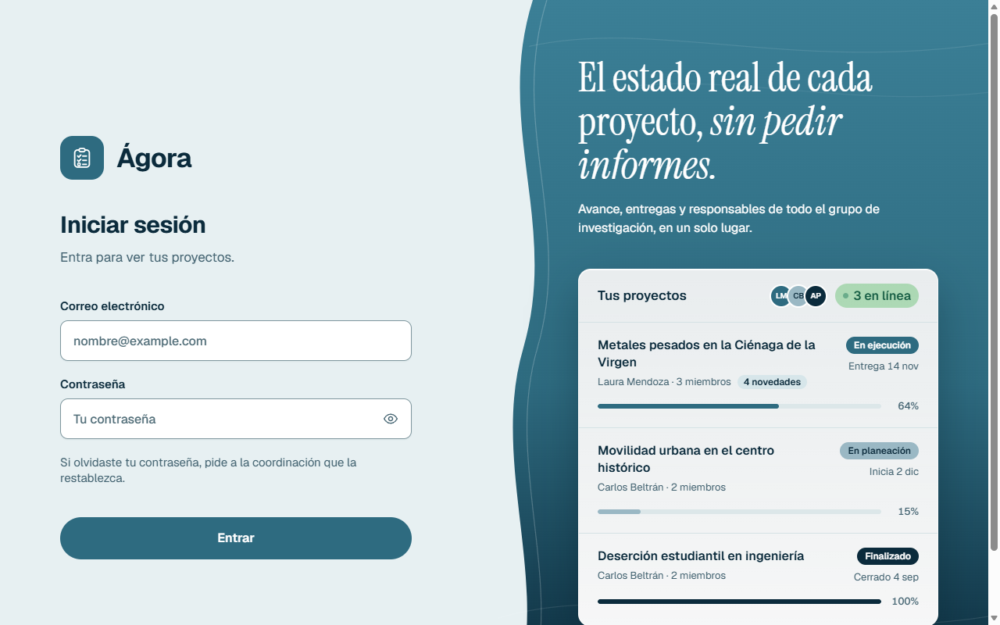
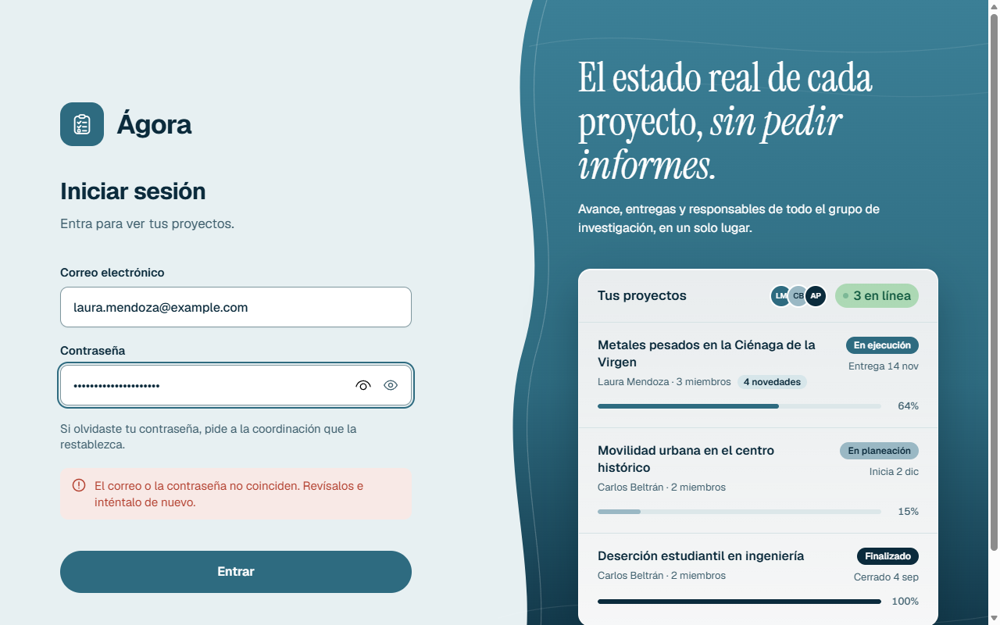
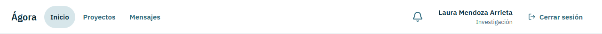
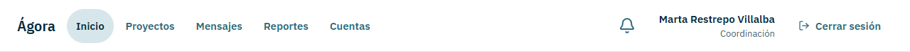
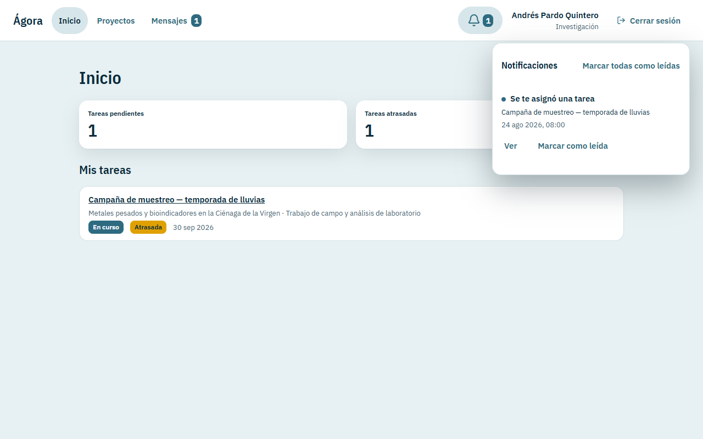
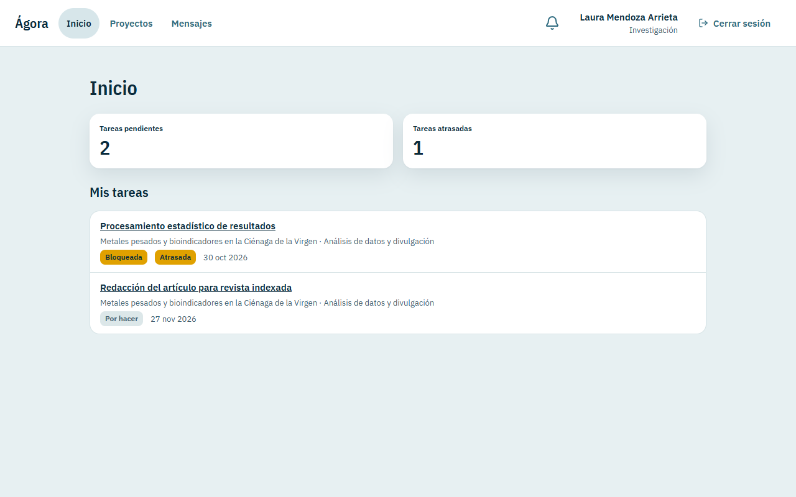
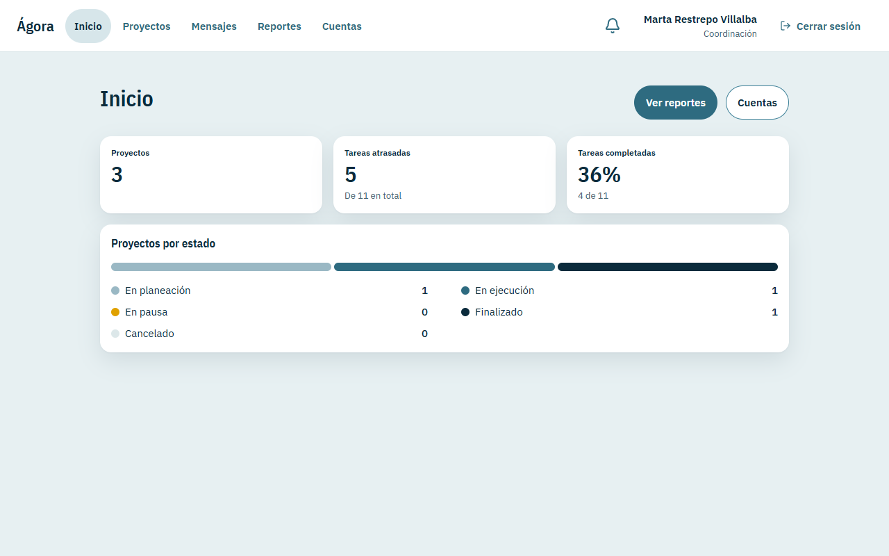

# Manual de usuario de Ágora

Ágora es la plataforma web donde un grupo de investigación planea, sigue y cierra sus proyectos: fases, tareas, avances, documentos y conversaciones, todo en un solo lugar.

Este manual está escrito para quien nunca ha usado el sistema. No necesita saber de programación. Cada paso dice qué botón pulsar y qué debería ver.

## Índice

1. [Entrar al sistema](#1-entrar-al-sistema)
2. [Conocer la pantalla](#2-conocer-la-pantalla)
3. [El inicio](#3-el-inicio)
4. [Proyectos](#4-proyectos)
5. [Dentro de un proyecto](#5-dentro-de-un-proyecto)
6. [Notificaciones](#6-notificaciones)
7. [Mensajes privados](#7-mensajes-privados)
8. [Reportes](#8-reportes)
9. [Cuentas](#9-cuentas)
10. [Roles y permisos](#10-roles-y-permisos)
11. [Qué hacer si algo falla](#11-qué-hacer-si-algo-falla)
12. [Usar Ágora desde el celular](#12-usar-ágora-desde-el-celular)
13. [Recorrido de demostración con dos cuentas](#13-recorrido-de-demostración-con-dos-cuentas)

---

## 1. Entrar al sistema

### 1.1 Dónde se obtiene la cuenta

Ágora no tiene registro propio. Nadie puede crearse una cuenta por su cuenta. La **coordinación de investigación** crea cada cuenta y le entrega su correo y una contraseña inicial.

Si todavía no tiene cuenta, pídala a la coordinación.

### 1.2 Cómo ingresar

1. Abra la dirección de Ágora que le entregaron.
2. Escriba su correo en **Correo electrónico**.
3. Escriba su contraseña en **Contraseña**. Para verla mientras escribe, pulse el ícono del ojo (**Mostrar contraseña**).
4. Pulse **Entrar**.

Si los datos son correctos, llega a su **Inicio**.

Captura: pantalla de entrada. A la derecha hay una ilustración con datos de ejemplo; no son sus proyectos.

| Botón | Para qué sirve |
| --- | --- |
| **Entrar** | Inicia la sesión con el correo y la contraseña escritos. |
| Ojo (**Mostrar contraseña**) | Muestra u oculta la contraseña que está escribiendo. |

Si el correo o la contraseña no son correctos, aparece un aviso rojo debajo de la contraseña:

> El correo o la contraseña no coinciden. Revísalos e inténtalo de nuevo.

Revise que no haya espacios de más y que las mayúsculas sean las correctas. Vuelva a intentarlo.

Captura: entrada con una contraseña equivocada.

### 1.3 Si olvidó su contraseña

En la pantalla de entrada aparece esta línea, debajo del campo de contraseña:

> Si olvidaste tu contraseña, pide a la coordinación que la restablezca.

Eso es todo lo que se puede hacer: ninguna persona puede cambiar su propia contraseña desde Ágora. La coordinación le genera una contraseña nueva y se la entrega. La contraseña anterior deja de servir y sus sesiones abiertas se cierran.

### 1.4 Cerrar sesión

Pulse **Cerrar sesión**, arriba a la derecha. En el celular, pulse **Cuenta** en la barra de abajo y luego **Cerrar sesión** (vea la sección [12](#12-usar-ágora-desde-el-celular)).

Cierre la sesión siempre que use un computador que no es suyo.

### 1.5 Cuentas de prueba

Para probar el sistema o dar una demostración hay seis cuentas de prueba. Las contraseñas **no** están en este manual: están en el apartado **Seed accounts** del archivo `README.md` de la raíz del repositorio.

| Correo | Nombre | Se muestra como | Papel en los proyectos de prueba |
| --- | --- | --- | --- |
| `coordinacion@example.com` | Marta Restrepo Villalba | Coordinación | Ve todos los proyectos; no pertenece a ninguno. |
| `laura.mendoza@example.com` | Laura Mendoza Arrieta | Investigación | Investigación principal del proyecto de metales pesados. |
| `carlos.beltran@example.com` | Carlos Beltrán Padilla | Investigación | Investigación principal de los proyectos de movilidad y de deserción. |
| `andres.pardo@example.com` | Andrés Pardo Quintero | Investigación | Coinvestigación en el proyecto de metales pesados. |
| `sofia.navarro@example.com` | Sofía Navarro Cabarcas | Investigación | Coinvestigación en metales pesados y en deserción. |
| `daniel.osorio@example.com` | Daniel Osorio Herrera | Investigación | Coinvestigación en el proyecto de movilidad. |

---

## 2. Conocer la pantalla

Cuando entra, toda la aplicación se organiza alrededor de una **barra superior** (en el celular, una **barra inferior**; vea la sección [12](#12-usar-ágora-desde-el-celular)).

### 2.1 La barra superior

De izquierda a derecha:

- **Ágora**: el nombre. Pulsarlo lo lleva al Inicio.
- Los **destinos**: **Inicio**, **Proyectos** y **Mensajes**. La coordinación ve además **Reportes** y **Cuentas**. El destino donde está queda resaltado.
- La **campana** (**Notificaciones**).
- Su **nombre** y, debajo, su rol: **Coordinación** o **Investigación**.
- **Cerrar sesión**.

Captura: barra superior de Laura Mendoza, cuenta de investigación.

Captura: barra superior de la coordinación. Tiene dos destinos más: Reportes y Cuentas.

| Botón | Para qué sirve |
| --- | --- |
| **Inicio** | Su pantalla de entrada al sistema (sección [3](#3-el-inicio)). |
| **Proyectos** | La lista de proyectos (sección [4](#4-proyectos)). |
| **Mensajes** | Sus conversaciones privadas (sección [7](#7-mensajes-privados)). |
| **Reportes** | Solo coordinación: cifras de todos los proyectos (sección [8](#8-reportes)). |
| **Cuentas** | Solo coordinación: crear y administrar cuentas (sección [9](#9-cuentas)). |
| Campana (**Notificaciones**) | Abre la bandeja de avisos (sección [6](#6-notificaciones)). |
| **Cerrar sesión** | Termina su sesión. |

### 2.2 Las marcas de «sin leer»

Cuando hay algo nuevo, aparece un número junto a **Mensajes** (mensajes privados sin leer) o sobre la campana (notificaciones sin leer). El número desaparece cuando lo lee.

### 2.3 La campana abierta

Al pulsar la campana se abre la bandeja. Cada aviso trae su título, el proyecto o la tarea de que se trata, y la fecha. La sección [6](#6-notificaciones) explica los botones.

Captura: la campana abierta en la cuenta de Andrés Pardo, que tiene una notificación sin leer.

### 2.4 Qué ve cada rol

- **Coordinación**: ve todos los proyectos y las cifras globales, y administra las cuentas. No pertenece a ningún proyecto y no puede escribir en sus chats.
- **Investigación**: ve solo los proyectos a los que pertenece. Dentro de cada proyecto puede ser **Investigación principal** (gestiona el proyecto) o **Coinvestigación** (trabaja en él).

La sección [10](#10-roles-y-permisos) tiene la tabla completa de qué puede hacer cada rol.

---

## 3. El inicio

Lo primero que ve al entrar. Es distinto según su rol.

### 3.1 Inicio de una persona de investigación

Muestra, de un vistazo, su trabajo pendiente:

- **Tareas pendientes**: cuántas tareas suyas faltan por terminar.
- **Tareas atrasadas**: cuántas de ellas ya pasaron su fecha límite.
- **Mis tareas**: la lista de esas tareas, con el nombre del proyecto y de la fase, su estado y su fecha límite. Las atrasadas llevan la marca **Atrasada**.

Captura: inicio de Laura Mendoza, con dos tareas pendientes y una atrasada.

| Marca | Significa |
| --- | --- |
| **Por hacer** | La tarea no ha empezado. |
| **En curso** | Se está trabajando en ella. |
| **En revisión** | Ya se trabajó y falta revisarla. |
| **Bloqueada** | No puede avanzar por ahora. |
| **Atrasada** | Pasó su fecha límite y no está terminada. |

### 3.2 Inicio de la coordinación

Muestra las cifras de todos los proyectos:

- **Proyectos**: cuántos hay.
- **Tareas atrasadas**: cuántas hay, **de** las que hay **en total**.
- **Tareas completadas**: el porcentaje y cuántas son, del total.
- **Proyectos por estado**: cuántos proyectos hay en cada estado.

Arriba hay dos botones: **Ver reportes** y **Cuentas**.

Captura: inicio de la coordinación con las cifras del seed.

| Botón | Para qué sirve |
| --- | --- |
| **Ver reportes** | Abre los reportes (sección [8](#8-reportes)). |
| **Cuentas** | Abre la administración de cuentas (sección [9](#9-cuentas)). |

<!-- continuará: sección 4 -->
