# Manual de usuario de Ágora

Ágora es la plataforma web donde un grupo de investigación planea, sigue y cierra sus proyectos: fases, tareas, avances, documentos y conversaciones, todo en un solo lugar.

Este manual está escrito para quien nunca ha usado el sistema. No necesita saber de programación. Cada paso dice qué botón pulsar y qué debería ver.

## Índice

1. [Entrar al sistema](#1-entrar-al-sistema)
2. [Conocer la pantalla](#2-conocer-la-pantalla)
3. [El inicio](#3-el-inicio)
4. [Proyectos](#4-proyectos)
5. [Dentro de un proyecto](#5-dentro-de-un-proyecto)
6. [Notificaciones](#6-notificaciones)
7. [Mensajes privados](#7-mensajes-privados)
8. [Reportes](#8-reportes)
9. [Cuentas](#9-cuentas)
10. [Roles y permisos](#10-roles-y-permisos)
11. [Qué hacer si algo falla](#11-qué-hacer-si-algo-falla)
12. [Usar Ágora desde el celular](#12-usar-ágora-desde-el-celular)
13. [Recorrido de demostración con dos cuentas](#13-recorrido-de-demostración-con-dos-cuentas)

---

## 1. Entrar al sistema

### 1.1 Dónde se obtiene la cuenta

Ágora no tiene registro propio. Nadie puede crearse una cuenta por su cuenta. La **coordinación de investigación** crea cada cuenta y le entrega su correo y una contraseña inicial.

Si todavía no tiene cuenta, pídala a la coordinación.

### 1.2 Cómo ingresar

1. Abra la dirección de Ágora que le entregaron.
2. Escriba su correo en **Correo electrónico**.
3. Escriba su contraseña en **Contraseña**. Para verla mientras escribe, pulse el ícono del ojo (**Mostrar contraseña**).
4. Pulse **Entrar**.

Si los datos son correctos, llega a su **Inicio**.

Captura: pantalla de entrada. A la derecha hay una ilustración con datos de ejemplo; no son sus proyectos.

| Botón | Para qué sirve |
| --- | --- |
| **Entrar** | Inicia la sesión con el correo y la contraseña escritos. |
| Ojo (**Mostrar contraseña**) | Muestra u oculta la contraseña que está escribiendo. |

Si el correo o la contraseña no son correctos, aparece un aviso rojo debajo de la contraseña:

> El correo o la contraseña no coinciden. Revísalos e inténtalo de nuevo.

Revise que no haya espacios de más y que las mayúsculas sean las correctas. Vuelva a intentarlo.

Captura: entrada con una contraseña equivocada.

### 1.3 Si olvidó su contraseña

En la pantalla de entrada aparece esta línea, debajo del campo de contraseña:

> Si olvidaste tu contraseña, pide a la coordinación que la restablezca.

Eso es todo lo que se puede hacer: ninguna persona puede cambiar su propia contraseña desde Ágora. La coordinación le genera una contraseña nueva y se la entrega. La contraseña anterior deja de servir y sus sesiones abiertas se cierran.

### 1.4 Cerrar sesión

Pulse **Cerrar sesión**, arriba a la derecha. En el celular, pulse **Cuenta** en la barra de abajo y luego **Cerrar sesión** (vea la sección [12](#12-usar-ágora-desde-el-celular)).

Cierre la sesión siempre que use un computador que no es suyo.

### 1.5 Cuentas de prueba

Para probar el sistema o dar una demostración hay seis cuentas de prueba. Las contraseñas **no** están en este manual: están en el apartado **Seed accounts** del archivo `README.md` de la raíz del repositorio.

| Correo | Nombre | Se muestra como | Papel en los proyectos de prueba |
| --- | --- | --- | --- |
| `coordinacion@example.com` | Marta Restrepo Villalba | Coordinación | Ve todos los proyectos; no pertenece a ninguno. |
| `laura.mendoza@example.com` | Laura Mendoza Arrieta | Investigación | Investigación principal del proyecto de metales pesados. |
| `carlos.beltran@example.com` | Carlos Beltrán Padilla | Investigación | Investigación principal de los proyectos de movilidad y de deserción. |
| `andres.pardo@example.com` | Andrés Pardo Quintero | Investigación | Coinvestigación en el proyecto de metales pesados. |
| `sofia.navarro@example.com` | Sofía Navarro Cabarcas | Investigación | Coinvestigación en metales pesados y en deserción. |
| `daniel.osorio@example.com` | Daniel Osorio Herrera | Investigación | Coinvestigación en el proyecto de movilidad. |

---

## 2. Conocer la pantalla

Cuando entra, toda la aplicación se organiza alrededor de una **barra superior** (en el celular, una **barra inferior**; vea la sección [12](#12-usar-ágora-desde-el-celular)).

### 2.1 La barra superior

De izquierda a derecha:

- **Ágora**: el nombre. Pulsarlo lo lleva al Inicio.
- Los **destinos**: **Inicio**, **Proyectos** y **Mensajes**. La coordinación ve además **Reportes** y **Cuentas**. El destino donde está queda resaltado.
- La **campana** (**Notificaciones**).
- Su **nombre** y, debajo, su rol: **Coordinación** o **Investigación**.
- **Cerrar sesión**.

Captura: barra superior de Laura Mendoza, cuenta de investigación.

Captura: barra superior de la coordinación. Tiene dos destinos más: Reportes y Cuentas.

| Botón | Para qué sirve |
| --- | --- |
| **Inicio** | Su pantalla de entrada al sistema (sección [3](#3-el-inicio)). |
| **Proyectos** | La lista de proyectos (sección [4](#4-proyectos)). |
| **Mensajes** | Sus conversaciones privadas (sección [7](#7-mensajes-privados)). |
| **Reportes** | Solo coordinación: cifras de todos los proyectos (sección [8](#8-reportes)). |
| **Cuentas** | Solo coordinación: crear y administrar cuentas (sección [9](#9-cuentas)). |
| Campana (**Notificaciones**) | Abre la bandeja de avisos (sección [6](#6-notificaciones)). |
| **Cerrar sesión** | Termina su sesión. |

### 2.2 Las marcas de «sin leer»

Cuando hay algo nuevo, aparece un número junto a **Mensajes** (mensajes privados sin leer) o sobre la campana (notificaciones sin leer). El número desaparece cuando lo lee.

### 2.3 La campana abierta

Al pulsar la campana se abre la bandeja. Cada aviso trae su título, el proyecto o la tarea de que se trata, y la fecha. La sección [6](#6-notificaciones) explica los botones.

Captura: la campana abierta en la cuenta de Andrés Pardo, que tiene una notificación sin leer.

### 2.4 Qué ve cada rol

- **Coordinación**: ve todos los proyectos y las cifras globales, y administra las cuentas. No pertenece a ningún proyecto y no participa en sus chats (sí puede escribir mensajes privados).
- **Investigación**: ve solo los proyectos a los que pertenece. Dentro de cada proyecto puede ser **Investigación principal** (gestiona el proyecto) o **Coinvestigación** (trabaja en él).

La sección [10](#10-roles-y-permisos) tiene la tabla completa de qué puede hacer cada rol.

---

## 3. El inicio

Lo primero que ve al entrar. Es distinto según su rol.

### 3.1 Inicio de una persona de investigación

Muestra, de un vistazo, su trabajo pendiente:

- **Tareas pendientes**: cuántas tareas suyas faltan por terminar.
- **Tareas atrasadas**: cuántas de ellas ya pasaron su fecha límite.
- **Mis tareas**: la lista de esas tareas, con el nombre del proyecto y de la fase, su estado y su fecha límite. Las atrasadas llevan la marca **Atrasada**.

Captura: inicio de Laura Mendoza, con dos tareas pendientes y una atrasada.

| Marca | Significa |
| --- | --- |
| **Por hacer** | La tarea no ha empezado. |
| **En curso** | Se está trabajando en ella. |
| **En revisión** | Ya se trabajó y falta revisarla. |
| **Bloqueada** | No puede avanzar por ahora. |
| **Atrasada** | Pasó su fecha límite y no está terminada. |

### 3.2 Inicio de la coordinación

Muestra las cifras de todos los proyectos:

- **Proyectos**: cuántos hay.
- **Tareas atrasadas**: cuántas hay, **de** las que hay **en total**.
- **Tareas completadas**: el porcentaje y cuántas son, del total.
- **Proyectos por estado**: cuántos proyectos hay en cada estado.

Arriba hay dos botones: **Ver reportes** y **Cuentas**.

Captura: inicio de la coordinación con las cifras del seed.

| Botón | Para qué sirve |
| --- | --- |
| **Ver reportes** | Abre los reportes (sección [8](#8-reportes)). |
| **Cuentas** | Abre la administración de cuentas (sección [9](#9-cuentas)). |

---

## 4. Proyectos

### 4.1 La lista de proyectos

Pulse **Proyectos**. Cada proyecto es una tarjeta con su título, su **estado**, quién lo dirige, cuántos miembros tiene y sus fechas. Pulse una tarjeta para abrirlo.

Cada persona ve solo los proyectos donde participa. La coordinación ve todos.

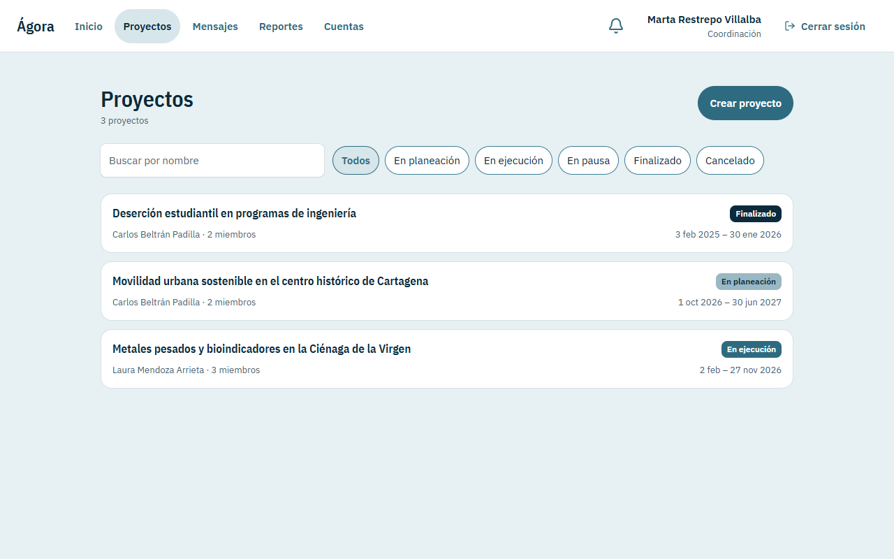

Captura: lista de proyectos vista por la coordinación (tres proyectos).

### 4.2 Buscar y filtrar

- **Buscar**: escriba parte del nombre en **Buscar por nombre**. La lista se actualiza sola.
- **Filtrar por estado**: pulse **Todos**, **En planeación**, **En ejecución**, **En pausa**, **Finalizado** o **Cancelado**. El filtro elegido queda resaltado.

Si nada coincide, aparece **Ningún proyecto coincide con la búsqueda** y el botón **Limpiar filtros**, que devuelve la lista completa.

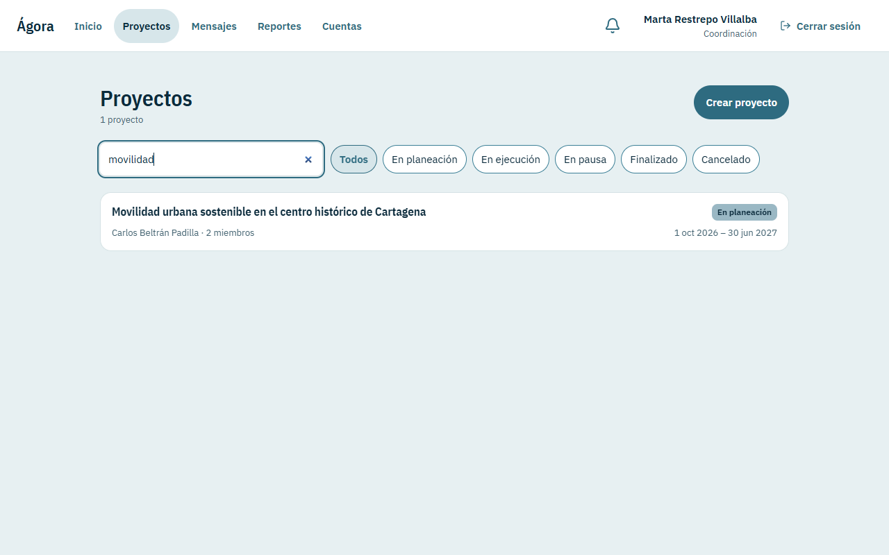

Captura: búsqueda de la palabra «movilidad».

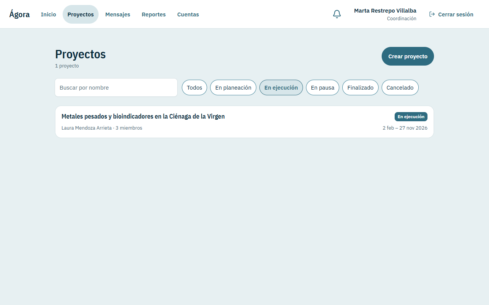

Captura: filtro **En ejecución**.

### 4.3 Estados de un proyecto

| Estado | Significa |
| --- | --- |
| **En planeación** | El proyecto se está preparando. Se trabaja en él igual que en los otros estados. |
| **En ejecución** | El proyecto está en marcha. Se trabaja en él normalmente. |
| **En pausa** | El proyecto está detenido por ahora. Se sigue pudiendo trabajar en él. |
| **Cancelado** | El proyecto se dio por cancelado. Se sigue pudiendo trabajar en él. |
| **Finalizado** | El proyecto se cerró. Queda **solo de lectura** y no se puede reabrir. |

La investigación principal cambia entre los cuatro primeros estados con el botón **Editar**. **Finalizado** no está en esa lista: se llega a él con **Cerrar proyecto** (sección [5.1](#51-resumen)).

### 4.4 Crear un proyecto (solo coordinación)

1. En **Proyectos**, pulse **Crear proyecto**.
2. Escriba el **Título** (entre 3 y 200 caracteres).
3. En **Investigación principal**, elija a la persona que dirigirá el proyecto.
4. Si quiere, complete **Descripción**, **Objetivos**, **Fecha de inicio**, **Fecha de fin** y **Presupuesto** (en pesos colombianos, solo números).
5. Pulse **Crear proyecto**.

Se abre el proyecto nuevo, en estado **En planeación**. La persona elegida recibe la notificación **Te sumaron a un proyecto**.

Si falta algo, el formulario avisa: **El título es obligatorio.** y **Elige quién dirige el proyecto.**

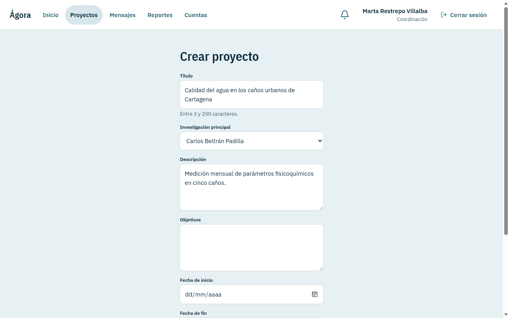

Captura: formulario de crear proyecto con título, investigación principal y descripción escritos.

| Botón | Para qué sirve |
| --- | --- |
| **Crear proyecto** | Guarda el proyecto y lo abre. |
| **Cancelar** | Vuelve sin guardar. |

---

## 5. Dentro de un proyecto

Al abrir un proyecto aparecen su título, su estado, quién lo dirige, sus fechas y una fila de pestañas: **Resumen**, **Cronograma**, **Tareas**, **Avances**, **Documentos** y **Conversación**. La coordinación no ve la pestaña **Conversación**. **← Proyectos** vuelve a la lista.

### 5.1 Resumen

Muestra la **Descripción**, los **Objetivos**, el avance de las **Tareas** (por ejemplo, «3 de 7 completadas (43%)» y cuántas están atrasadas), el **Presupuesto** y los **Miembros**.

En **Miembros** aparece cada persona con su correo y su papel: **Investigación principal** o **Coinvestigación**. Un punto verde y **En línea** indican quién tiene Ágora abierto en ese momento; arriba se cuenta cuántas personas están en línea.

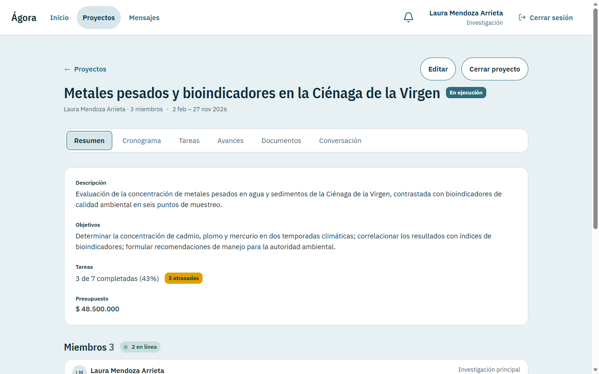

Captura: resumen del proyecto de metales pesados, visto por su investigación principal, con dos personas en línea.

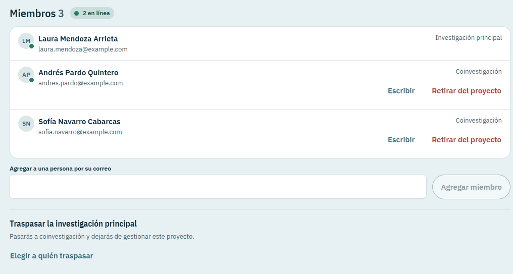

Captura: lista de miembros, con **Escribir** y **Retirar del proyecto**.

| Botón | Quién lo ve | Para qué sirve |
| --- | --- | --- |
| **Editar** | Investigación principal | Abre el formulario del proyecto: título, estado, descripción, objetivos, fechas y presupuesto. **Guardar cambios** se activa cuando cambia algo. |
| **Cerrar proyecto** | Investigación principal | Pasa el proyecto a **Finalizado**. Pide confirmación. |
| **Escribir** | Todos | Abre una conversación privada con esa persona (sección [7](#7-mensajes-privados)). |
| **Retirar del proyecto** | Investigación principal | Saca a un miembro del proyecto. Pide confirmación. |
| **Agregar miembro** | Investigación principal | Suma a una persona por su correo. |
| **Elegir a quién traspasar** | Investigación principal | Entrega la dirección del proyecto a otro miembro. |

**Agregar un miembro.** Escriba el correo en **Agregar a una persona por su correo** y pulse **Agregar miembro**. La persona recibe la notificación **Te sumaron a un proyecto**. Si el correo no tiene una cuenta activa, aparece **No hay ninguna cuenta activa con ese correo.**

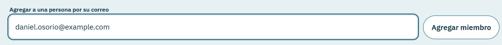

Captura: correo escrito en el campo de agregar miembro.

**Traspasar la investigación principal.** Pulse **Elegir a quién traspasar**, elija a la persona en **Quién asume** y pulse **Traspasar**. Usted pasa a **Coinvestigación** y deja de poder gestionar el proyecto. No se puede deshacer: solo la nueva investigación principal podría devolverle el cargo.

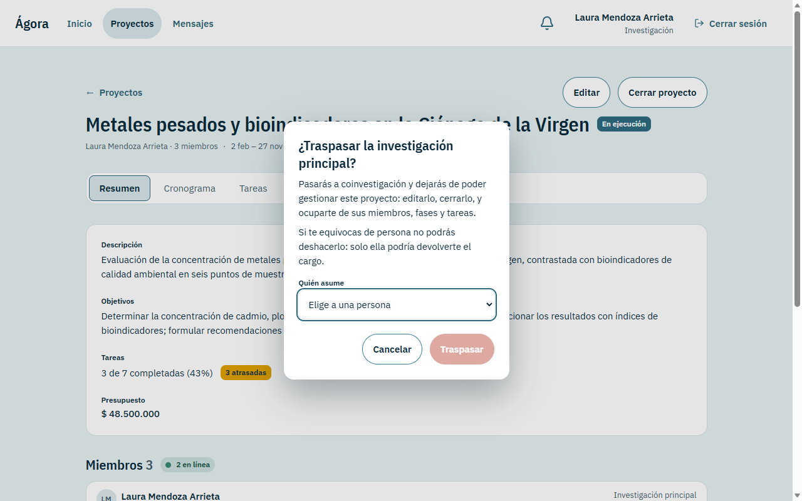

Captura: diálogo **¿Traspasar la investigación principal?**

**Retirar a un miembro.** Pulse **Retirar del proyecto** junto a su nombre y confirme. Esa persona pierde el acceso al proyecto y a su conversación.

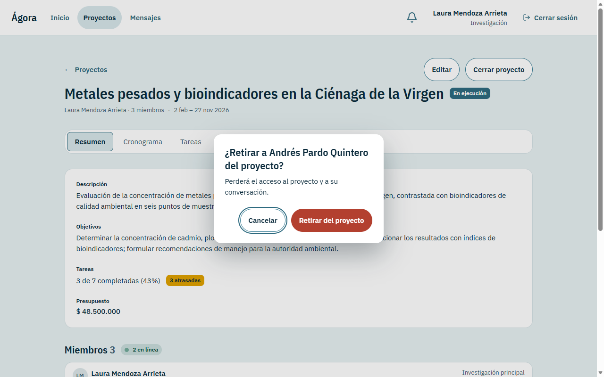

Captura: diálogo **¿Retirar a Andrés Pardo Quintero del proyecto?**

**Cerrar el proyecto.** Pulse **Cerrar proyecto** y confirme. Es definitivo: queda **Finalizado**, de solo lectura, con la fecha de cierre.

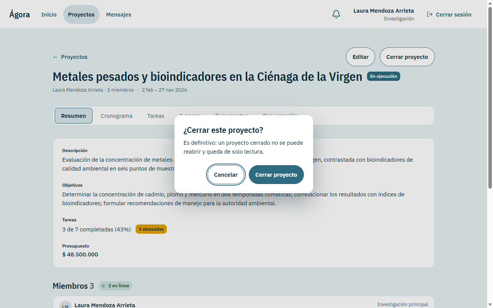

Captura: diálogo **¿Cerrar este proyecto?**

### 5.2 Cronograma

El cronograma es la lista ordenada de **fases** del proyecto. Cada fase muestra su número, su estado (**Pendiente**, **En curso** o **Terminada**), su descripción, sus fechas y cuántas tareas tiene.

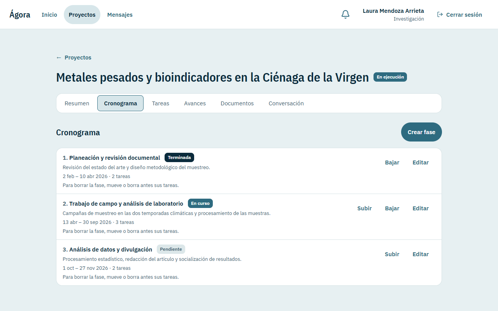

Captura: cronograma de tres fases, con **Subir**, **Bajar** y **Editar**.

| Botón | Quién lo ve | Para qué sirve |
| --- | --- | --- |
| **Crear fase** | Investigación principal | Abre el formulario de una fase nueva. |
| **Subir** / **Bajar** | Investigación principal | Cambia el orden: mueve la fase una posición. |
| **Editar** | Investigación principal | Cambia los datos de la fase. |
| **Borrar** | Investigación principal | Borra la fase. Solo aparece en las fases sin tareas; en las demás dice **Para borrar la fase, mueve o borra antes sus tareas.** |

Para crear una fase: pulse **Crear fase**, escriba el **Nombre** (obligatorio: si falta, dice **El nombre es obligatorio.**), y si quiere la **Descripción**, el **Estado** y las fechas. Pulse **Crear fase**. Al editar, el botón dice **Guardar cambios**.

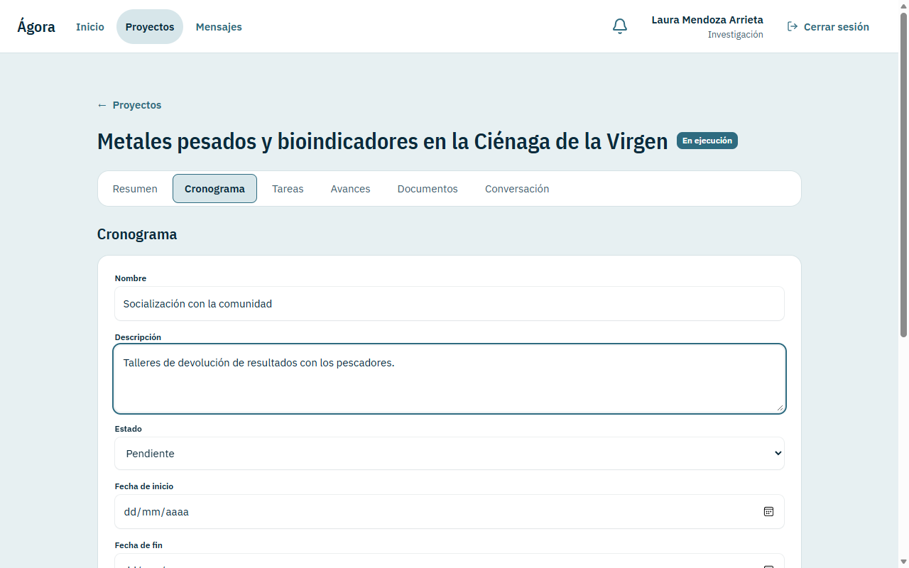

Captura: formulario de fase con nombre y descripción.

### 5.3 Tareas

Las tareas están agrupadas por fase. Cada una muestra su título, su estado, su **Prioridad** (baja, media o alta), su descripción, quién la tiene y sus fechas, y si **Depende de** otra tarea.

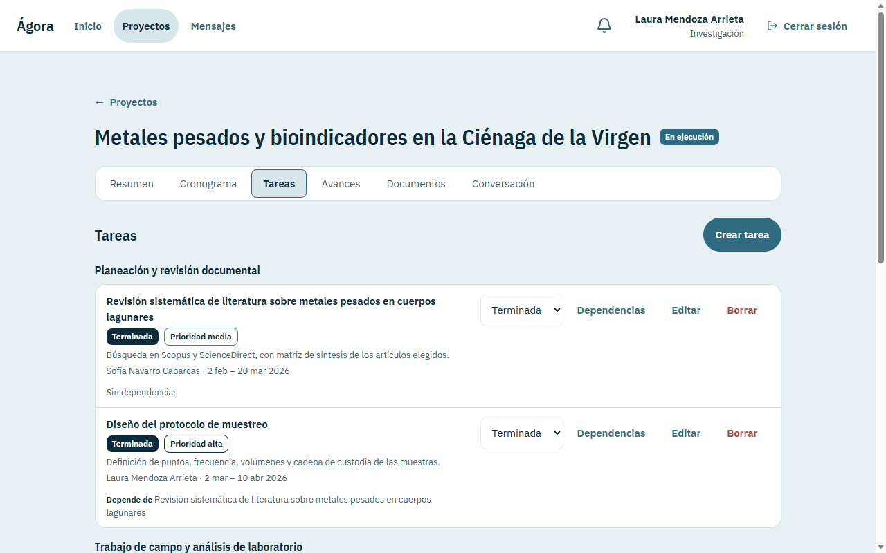

Captura: lista de tareas de la investigación principal.

| Marca | Significa |
| --- | --- |
| **Por hacer**, **En curso**, **En revisión**, **Bloqueada**, **Terminada** | El estado de la tarea. Se cambia en el desplegable de cada tarea. |
| **Prioridad baja**, **Prioridad media**, **Prioridad alta** | Qué tan urgente es. |
| **Depende de** … | La tarea necesita que otra termine antes. |

| Botón | Quién lo ve | Para qué sirve |
| --- | --- | --- |
| Desplegable de estado | Investigación principal, y la persona a quien se asignó la tarea | Cambia el estado. Los demás miembros lo ven al instante. |
| **Crear tarea** | Investigación principal | Abre el formulario de una tarea nueva. |
| **Dependencias** | Investigación principal | Muestra y cambia de qué tareas depende. |
| **Editar** | Investigación principal | Cambia los datos de la tarea. |
| **Borrar** | Investigación principal | Borra la tarea. Pide confirmación. |

**Crear una tarea.** Pulse **Crear tarea** y complete **Título** (obligatorio: **El título es obligatorio.**), **Descripción**, **Fase**, **Responsable**, **Estado**, **Prioridad**, **Fecha de inicio** y **Fecha límite**. Pulse **Crear tarea**. Si elige un responsable, esa persona recibe la notificación **Se te asignó una tarea**.

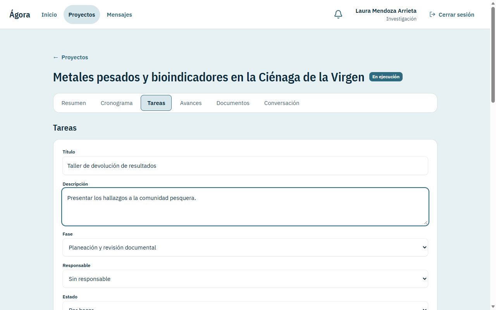

Captura: formulario de tarea nueva.

**Dependencias.** Pulse **Dependencias** en una tarea. Verá de cuáles depende, con **Quitar** junto a cada una. Para sumar otra, elíjala en **Elige una tarea** y pulse **Agregar dependencia**.

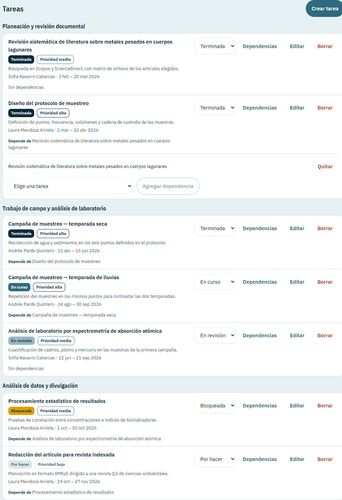

Captura: panel de dependencias de la tarea «Diseño del protocolo de muestreo».

**Borrar una tarea.** El diálogo dice: **La tarea se borra y no se puede recuperar.** Pulse **Borrar tarea** o **Cancelar**.

### 5.4 Avances

Un avance es una anotación del equipo sobre lo que va pasando: una reunión, un resultado, un imprevisto. Cada uno muestra quién lo escribió, cuándo, y la tarea a la que se refiere si tiene una.

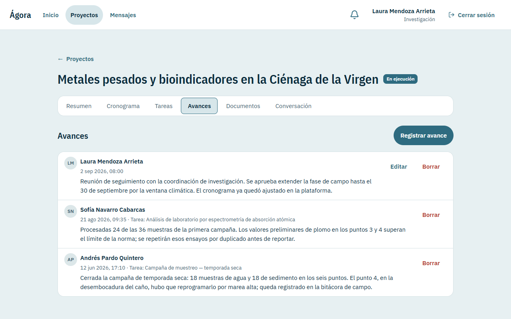

Captura: lista de avances del proyecto.

| Botón | Quién lo ve | Para qué sirve |
| --- | --- | --- |
| **Registrar avance** | Investigación principal y coinvestigación | Abre el formulario. |
| **Editar** | Solo quien escribió el avance | Cambia el texto. Al editar, el botón dice **Guardar cambios**. |
| **Borrar** | Quien lo escribió y la investigación principal | Borra el avance. Pide confirmación: **Desaparece del historial del proyecto y no se puede recuperar.** |

Para registrar un avance: pulse **Registrar avance**, escriba en **Qué avanzó**, elija una **Tarea** si corresponde (es opcional) y pulse **Registrar avance**.

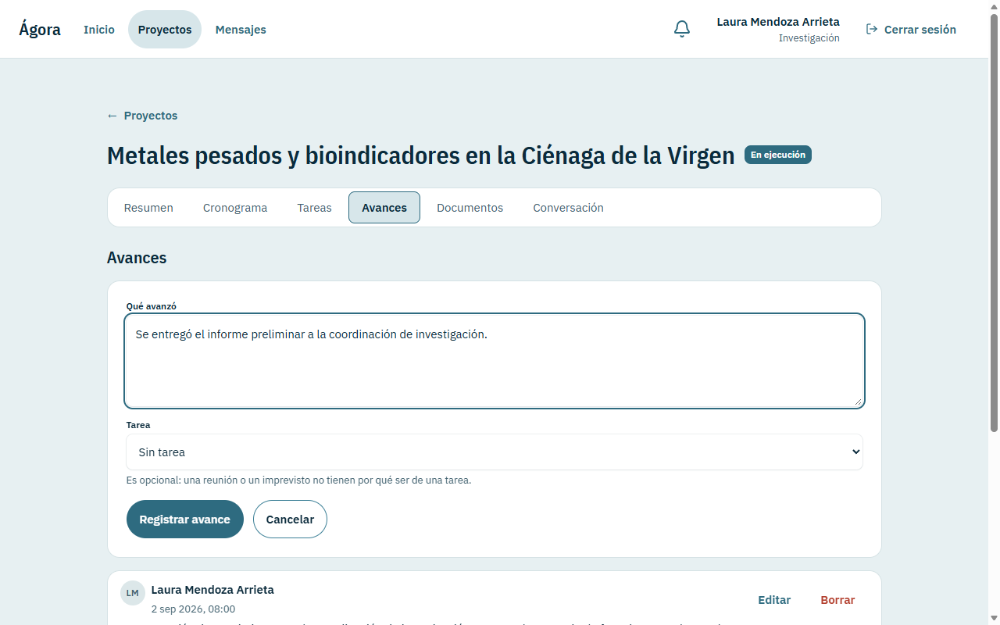

Captura: formulario de avance con el texto escrito.

Si no hay ninguno, la pantalla dice **Este proyecto todavía no tiene avances**. Los avances nuevos aparecen en la pantalla de los demás sin que tengan que recargar.

### 5.5 Documentos

Aquí se guardan los archivos del proyecto. Cada documento muestra su nombre, su **Versión**, su tamaño, quién lo subió y cuándo, y la tarea a la que se refiere si tiene una.

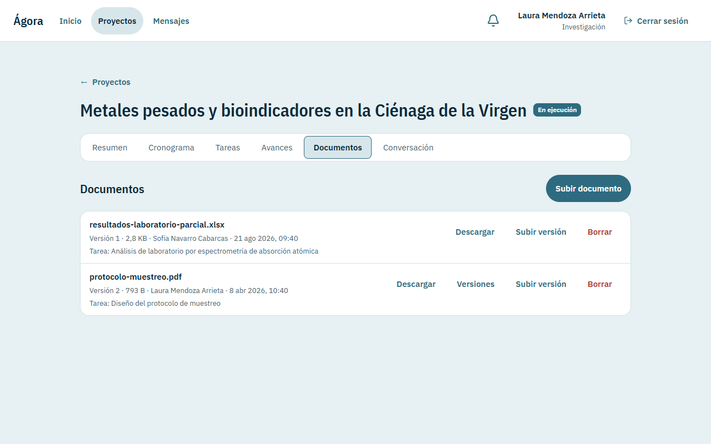

Captura: lista de documentos del proyecto.

| Botón | Quién lo ve | Para qué sirve |
| --- | --- | --- |
| **Subir documento** | Investigación principal y coinvestigación | Sube un archivo nuevo. |
| **Descargar** | Todos, incluida la coordinación | Guarda el archivo en su computador. |
| **Subir versión** | Investigación principal y coinvestigación | Sube una versión nueva de ese archivo. |
| **Versiones** | Todos | Muestra todas las versiones; la más reciente lleva **La última**. |
| **Borrar** | Investigación principal (todos) y quien subió el archivo (el suyo) | Borra el archivo. Pide confirmación. |

Para subir un documento: pulse **Subir documento**, pulse **Elegir archivo**, elija el archivo (el tamaño máximo es **20 MB**), elija una **Tarea** si corresponde y pulse **Subir documento**.

Pulse **Versiones** para ver todas. Cada versión tiene su propio **Descargar** y **Borrar**.

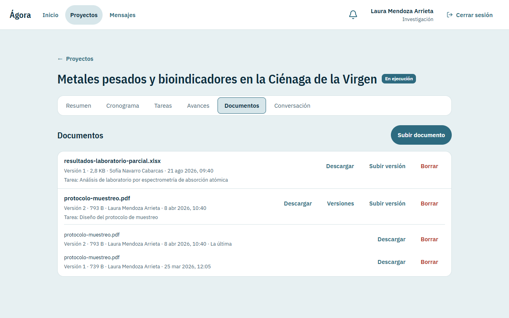

Captura: versiones del archivo «protocolo-muestreo.pdf».

Si el archivo pesa más de 20 MB, aparece **El archivo no puede superar 20 MB.** y el archivo no se acepta. Elija otro más liviano.

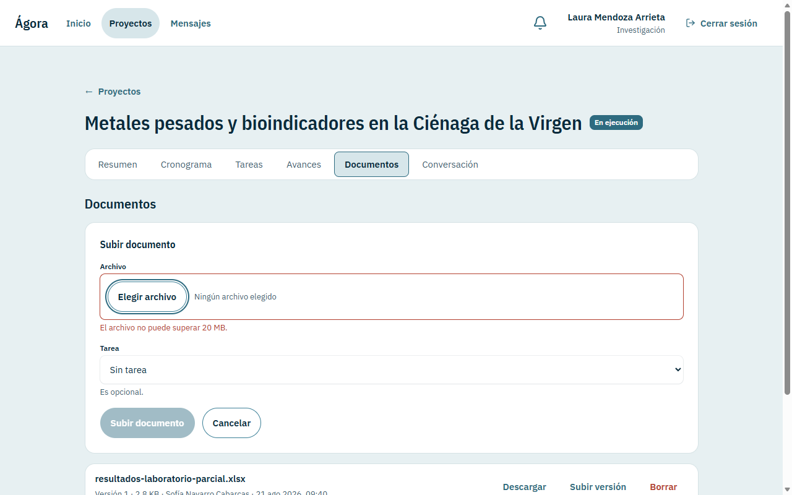

Captura: aviso al elegir un archivo de 21 MB.

Al borrar la versión más reciente, el diálogo avisa: la anterior vuelve a ser la última, y es la que verá todo el equipo. El archivo borrado no se puede recuperar.

### 5.6 Conversación

Es el chat del proyecto. Lo usan la investigación principal y la coinvestigación; la coordinación no lo ve. Los mensajes propios aparecen a la derecha y los de los demás a la izquierda, con el nombre y la hora, agrupados por día.

- Escriba en el campo **Mensaje** y pulse **Enviar mensaje**, o pulse la tecla **Enter**. El botón se activa cuando hay texto.
- Un punto verde y **En línea** junto a una persona indican que tiene Ágora abierto.
- Los mensajes de los demás llegan al instante, sin recargar.
- En la pestaña **Conversación** aparece un número cuando hay mensajes sin leer.

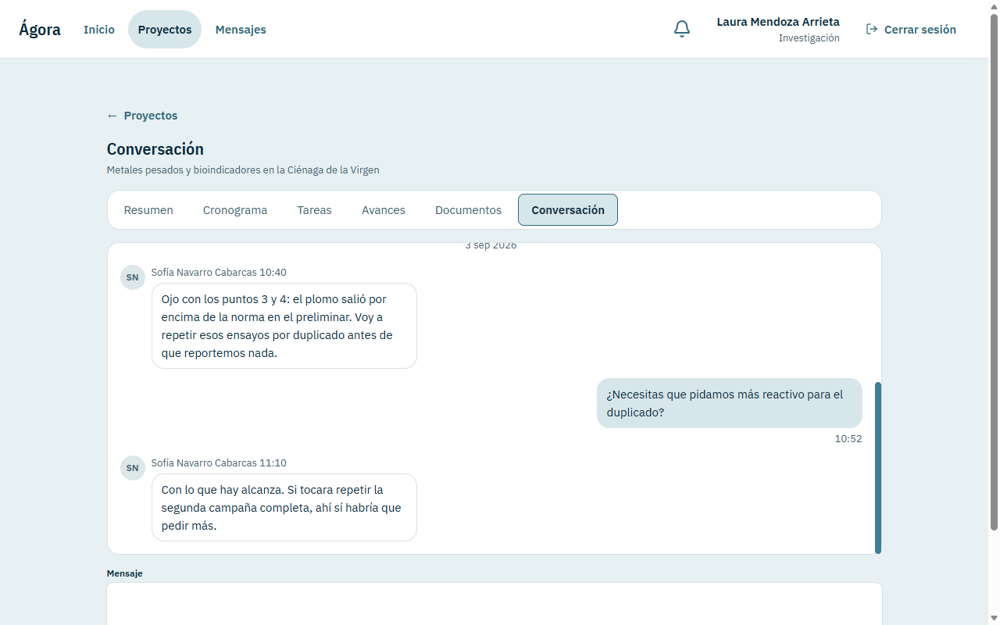

Captura: chat del proyecto de metales pesados, con Andrés Pardo en línea.

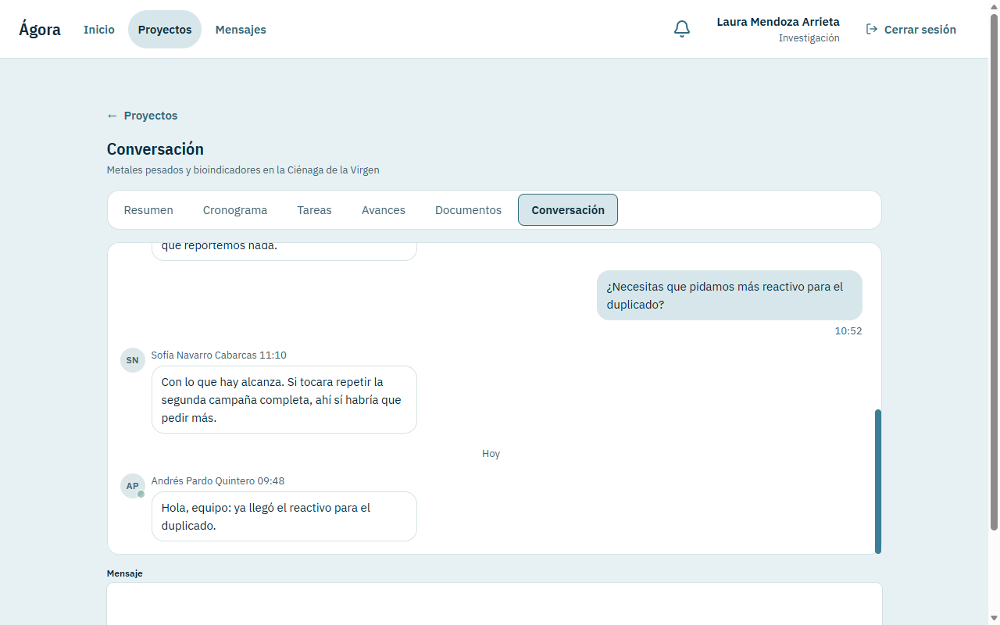

Captura: la vista de Laura Mendoza cuando Andrés Pardo escribe. La hora de ese mensaje es la del momento de la captura.

Si el proyecto está **Finalizado**, la conversación queda de solo lectura (sección [11](#11-qué-hacer-si-algo-falla)).

---

## 6. Notificaciones

La campana avisa de dos cosas:

- **Te sumaron a un proyecto**: la coordinación lo nombró investigación principal de un proyecto nuevo, o alguien lo agregó como miembro.
- **Se te asignó una tarea**: la investigación principal le asignó una tarea.

Llegan al instante, sin recargar. Mientras haya avisos sin leer, la campana muestra un número.

Pulse la campana. Se abre la bandeja con cada aviso: su título, el proyecto o la tarea y la fecha.

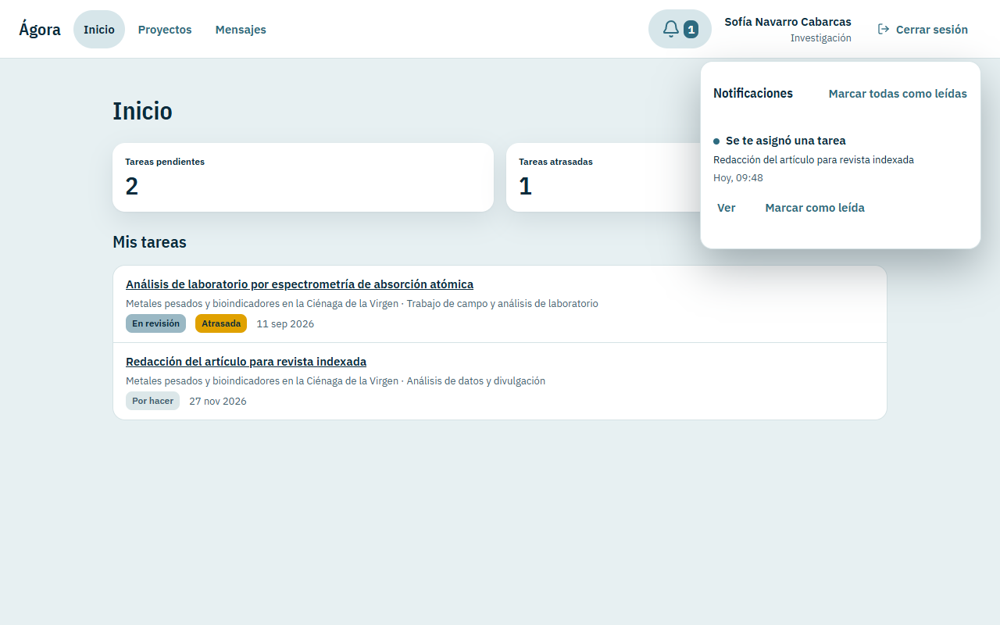

Captura: la campana de Sofía Navarro con el aviso de una tarea que Laura Mendoza acaba de asignarle.

| Botón | Para qué sirve |
| --- | --- |
| **Ver** | Abre el proyecto (o la pestaña **Tareas**, si el aviso es de una tarea) y marca el aviso como leído. |
| **Marcar como leída** | Marca ese aviso como leído sin abrirlo. |
| **Marcar todas como leídas** | Marca todos los avisos como leídos. |

Si no tiene avisos, la bandeja dice: **No tienes notificaciones. Aquí llegan los proyectos a los que te suman y las tareas que te asignan.**

---

## 7. Mensajes privados

Sirven para escribir a una sola persona. Pulse **Mensajes**.

La pantalla lista sus conversaciones: la persona, el último mensaje (con **Tú:** si lo escribió usted), la fecha y, si hay mensajes sin leer, un número. Pulse una conversación para abrirla.

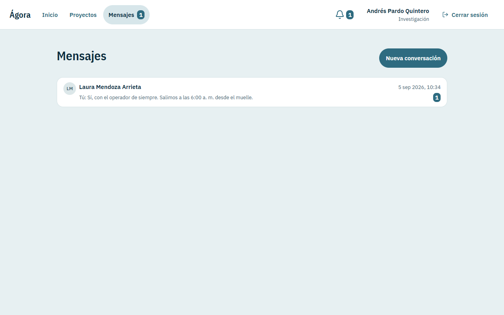

Captura: **Mensajes** de Andrés Pardo, con un mensaje sin leer.

Dentro de la conversación, escriba en **Mensaje** y pulse **Enviar mensaje**. **← Mensajes** vuelve a la lista.

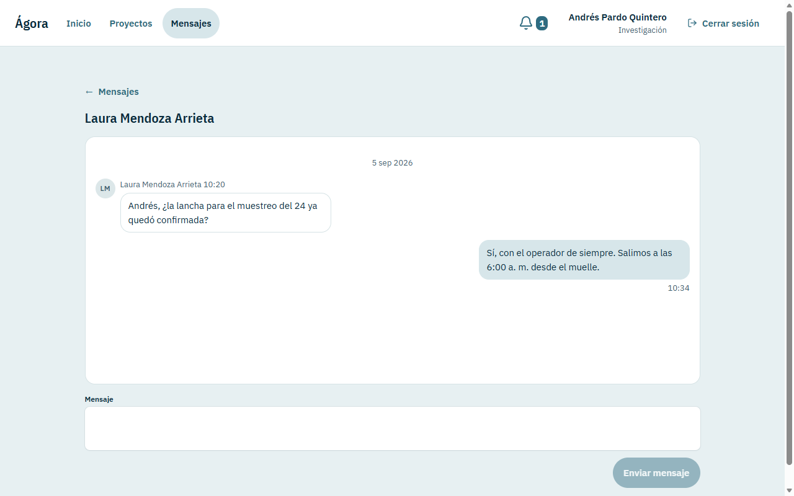

Captura: conversación entre Andrés Pardo y Laura Mendoza.

### 7.1 Empezar una conversación

Hay dos caminos:

- En **Mensajes**, pulse **Nueva conversación**. Aparece **¿Con quién?** con las personas a quienes puede escribir. Pulse **Escribir** junto a una. **Cerrar** cierra esa lista.
- Dentro de un proyecto, en **Miembros**, pulse **Escribir** junto a la persona.

Si todavía no hay mensajes, la conversación dice **Todavía no hay mensajes** y le invita a escribir el primero.

Una persona de investigación puede escribir a quienes comparten un proyecto con ella y a la coordinación. La coordinación puede escribir a cualquier cuenta.

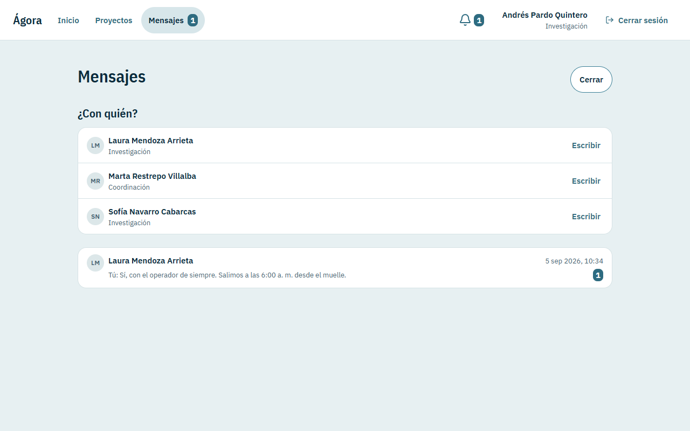

Captura: la lista **¿Con quién?** de Andrés Pardo.

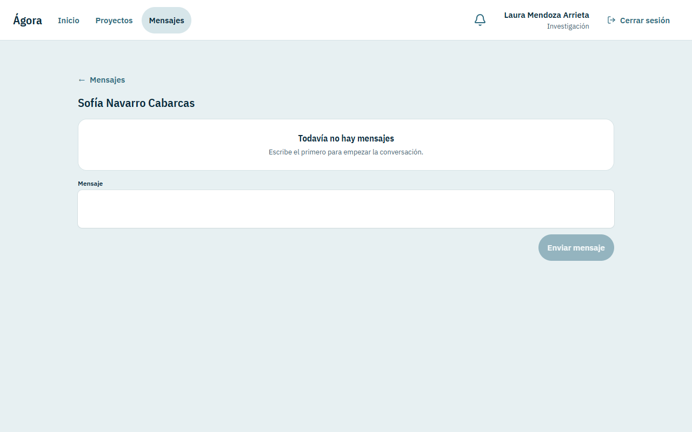

Captura: conversación vacía abierta desde **Escribir**, en la cuenta de Laura Mendoza, con Sofía Navarro.

### 7.2 El contador de no leídos

Los mensajes nuevos llegan al instante. Mientras haya mensajes sin leer, aparece un número junto a **Mensajes** y otro en la conversación. Desaparecen cuando abre la conversación.

| Botón | Para qué sirve |
| --- | --- |
| **Nueva conversación** | Muestra a quién puede escribir. |
| **Escribir** | Abre (o crea) la conversación con esa persona. |
| **Cerrar** | Cierra la lista **¿Con quién?** |
| **Enviar mensaje** | Envía el mensaje escrito. |

---

## 8. Reportes

Solo la coordinación. Pulse **Reportes** (o **Ver reportes** en el Inicio).

Muestra:

- **Proyectos**: cuántos hay.
- **Tareas atrasadas**: cuántas, de cuántas en total.
- **Tareas completadas**: el porcentaje y la cuenta.
- **Proyectos por estado**: una barra y la cifra de cada estado.
- **Por proyecto**: cada proyecto con su estado, cuántas tareas lleva completadas (y el porcentaje) y cuántas están atrasadas. Pulse un proyecto para abrirlo.

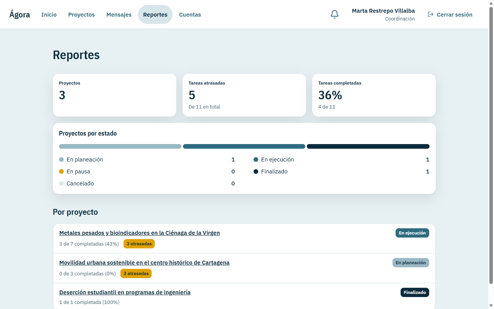

Captura: reportes de la coordinación con los datos del seed.

Una persona de investigación que intenta entrar a Reportes vuelve a su Inicio.

---

## 9. Cuentas

Solo la coordinación. Pulse **Cuentas** (o **Cuentas** en el Inicio). Desde aquí se crean y administran todas las cuentas.

La lista muestra, de cada cuenta, el nombre, el correo y el rol (**Coordinación** o **Investigación**). Su propia cuenta lleva la marca **Tú** y no tiene acciones. Las cuentas desactivadas llevan la marca **Desactivada**.

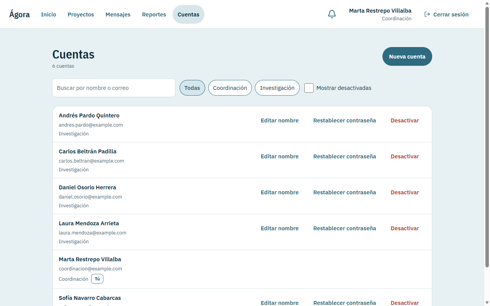

Captura: lista de cuentas de la coordinación.

- **Buscar por nombre o correo**: filtra la lista.
- **Todas**, **Coordinación**, **Investigación**: filtra por rol.
- **Mostrar desactivadas**: por defecto las cuentas desactivadas no se ven. Active esta casilla para verlas.

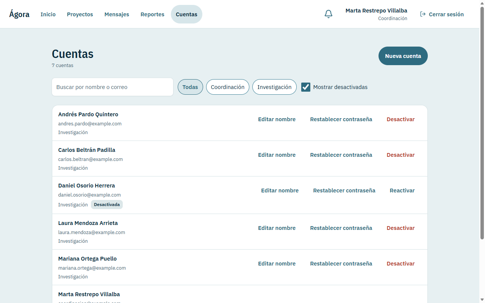

Captura: con **Mostrar desactivadas** activa, Daniel Osorio aparece con la marca **Desactivada** y el botón **Reactivar**.

| Botón | Para qué sirve |
| --- | --- |
| **Nueva cuenta** | Crea una cuenta. |
| **Editar nombre** | Cambia el nombre de la persona. No se puede cambiar el correo ni el rol. |
| **Restablecer contraseña** | Genera una contraseña nueva. Pide confirmación. |
| **Desactivar** | Impide que la persona entre. Pide confirmación. |
| **Reactivar** | Devuelve el acceso a una cuenta desactivada. |

### 9.1 Crear una cuenta

1. Pulse **Nueva cuenta**.
2. Escriba el **Nombre completo** (entre 3 y 150 caracteres) y el **Correo**.
3. Pulse **Crear cuenta**.

Nadie escribe la contraseña: Ágora la genera sola. Si el correo ya tiene una cuenta, dice **Ya hay una cuenta con ese correo.**

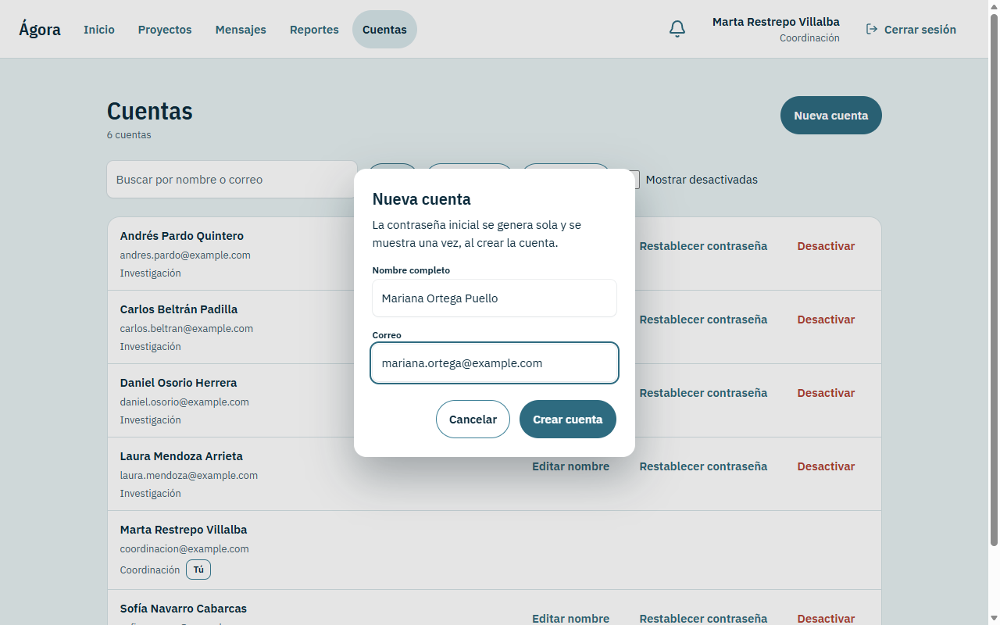

Captura: diálogo **Nueva cuenta** con el nombre y el correo escritos.

### 9.2 La contraseña que se muestra una sola vez

Al crear la cuenta, el cuadro cambia a **Cuenta creada** y muestra la contraseña inicial. Pulse **Copiar contraseña** para copiarla, entréguela a la persona por un medio seguro y pulse **Listo**.

**Esta contraseña no se vuelve a mostrar.** Al cerrar el cuadro desaparece de la pantalla y ninguna pantalla de Ágora permite verla de nuevo. Por eso conviene copiarla y entregarla antes de cerrar. Si se pierde, la solución es restablecerla.

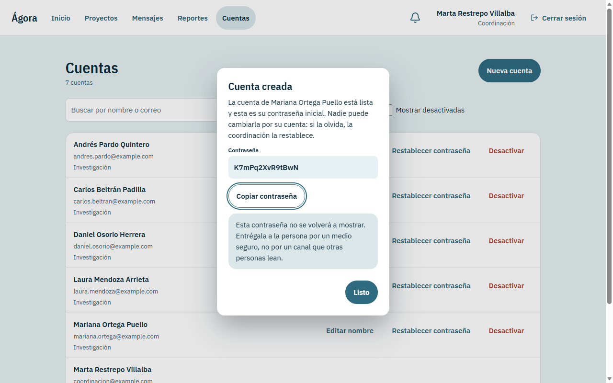

Captura: cuadro **Cuenta creada**. La contraseña de la imagen es de ejemplo; la real es distinta cada vez.

### 9.3 Restablecer una contraseña

Úselo cuando alguien olvidó la suya.

1. En la fila de la persona, pulse **Restablecer contraseña**.
2. Confirme en **Restablecer contraseña**.
3. Aparece **Contraseña restablecida** con la contraseña nueva. Cópiela, entréguela por un medio seguro y pulse **Listo**.

La contraseña anterior deja de servir y las sesiones abiertas de esa persona se cierran. También funciona con una cuenta desactivada, y no la reactiva.

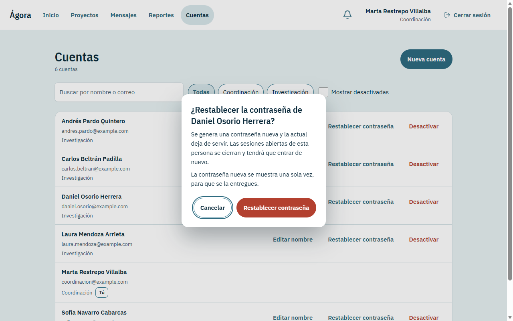

Captura: diálogo **¿Restablecer la contraseña de Daniel Osorio Herrera?**

### 9.4 Desactivar y reactivar

**Desactivar** sirve cuando una persona ya no debe entrar. Pulse **Desactivar** y confirme. Sus sesiones se cierran y no podrá volver a entrar mientras esté desactivada. Lo que tenga abierto puede seguir respondiendo hasta 15 minutos. Sus proyectos, tareas y mensajes se conservan.

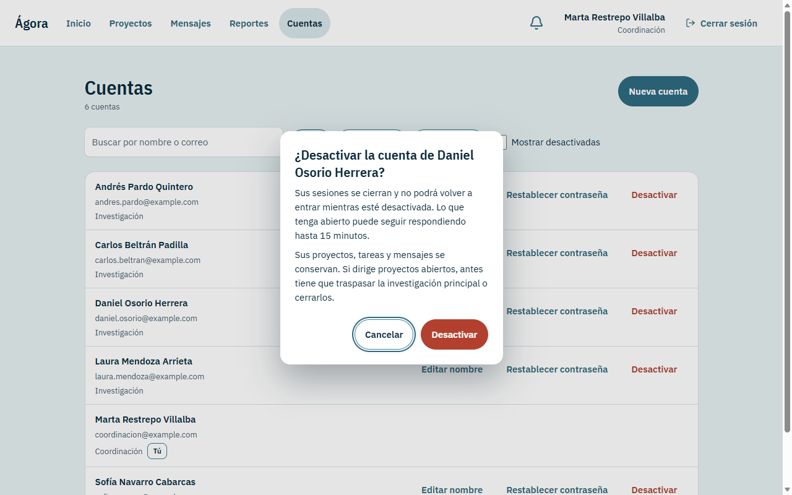

Captura: diálogo **¿Desactivar la cuenta de Daniel Osorio Herrera?**

Si la persona **dirige un proyecto abierto**, no se puede desactivar. El diálogo se queda abierto con un aviso en rojo que indica qué hacer: pedirle que traspase la investigación principal o cierre esos proyectos, y volver a intentarlo.

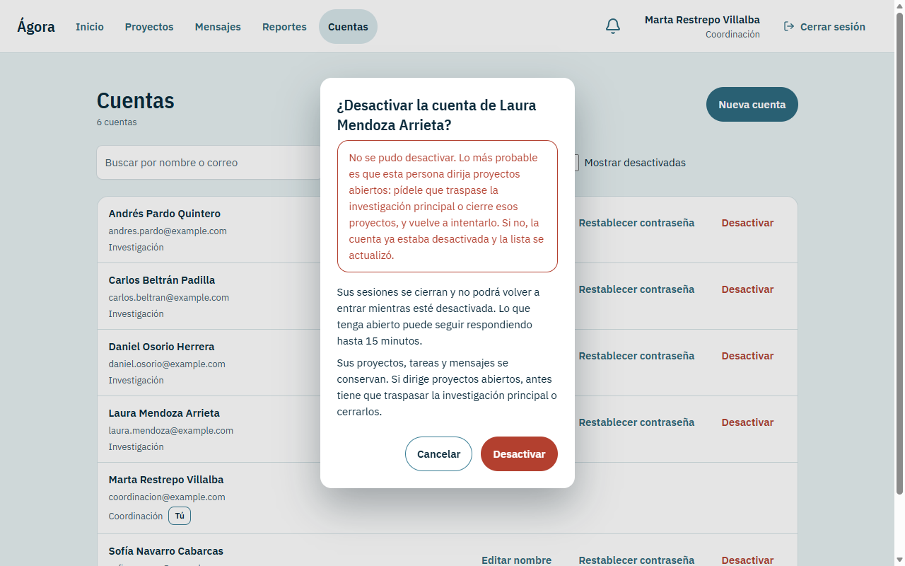

Captura: aviso al intentar desactivar a Laura Mendoza, que dirige un proyecto abierto.

**Reactivar** devuelve el acceso de inmediato y no pide confirmación. La persona vuelve a entrar con su contraseña (la última que tuvo).

**Qué le pasa a la persona desactivada:** al intentar entrar ve **Esta cuenta está desactivada. Pide a la coordinación que la active.** (sección [11](#11-qué-hacer-si-algo-falla)).

---

## 10. Roles y permisos

Tabla hecha entrando con cada rol y mirando qué botones aparecen. «Coinvestigación» e «Investigación principal» son papeles dentro de un proyecto concreto.

| Qué puede hacer | Coordinación | Investigación principal | Coinvestigación |
| --- | :---: | :---: | :---: |
| Ver los proyectos | Todos | Los suyos | Los suyos |
| Ver cifras de todos los proyectos (**Reportes**) | Sí | No | No |
| Crear cuentas, restablecer, desactivar (**Cuentas**) | Sí | No | No |
| Crear un proyecto | Sí | No | No |
| Editar el proyecto, cerrarlo | No | Sí | No |
| Agregar, retirar miembros; traspasar la dirección | No | Sí | No |
| Crear, editar, reordenar y borrar fases | No | Sí | No |
| Crear, editar y borrar tareas; dependencias | No | Sí | No |
| Cambiar el estado de una tarea | No | Todas | Solo las suyas |
| Registrar un avance | No | Sí | Sí |
| Editar un avance | No | Solo los suyos | Solo los suyos |
| Borrar un avance | No | Todos | Solo los suyos |
| Subir documentos y versiones | No | Sí | Sí |
| Descargar documentos y ver versiones | Sí | Sí | Sí |
| Borrar documentos | No | Todos | Solo los que subió |
| Chat del proyecto | No participa | Sí | Sí |
| Mensajes privados | Sí | Sí | Sí |
| Notificaciones | Sí | Sí | Sí |

En un proyecto **Finalizado** nadie puede cambiar nada, sea cual sea su papel.

---

## 11. Qué hacer si algo falla

### «Reconectando con el servidor»

Aparece un aviso arriba: **Reconectando con el servidor.** En los chats agrega **Puedes seguir escribiendo.** Ágora perdió la conexión y la está recuperando sola. Espere unos segundos: cuando vuelve, el aviso desaparece. Si no vuelve, revise su internet y recargue la página.

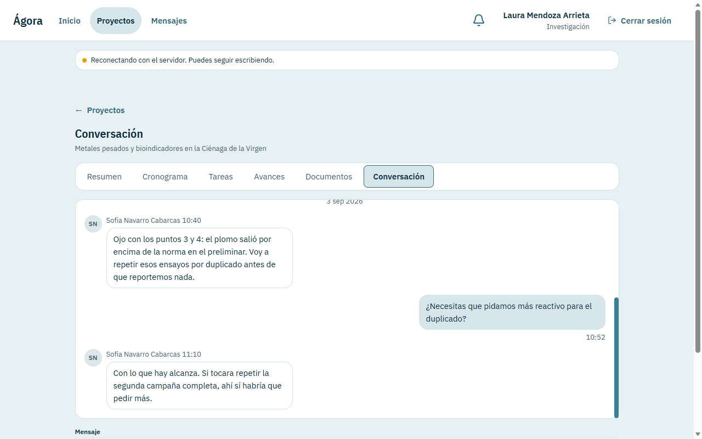

Captura: aviso en el chat del proyecto cuando se cae la conexión.

### «Tu sesión terminó»

La pantalla dice: **Por seguridad, tu sesión se cerró. Vuelve a iniciar sesión para seguir trabajando.** Pulse **Volver a iniciar sesión** y entre de nuevo.

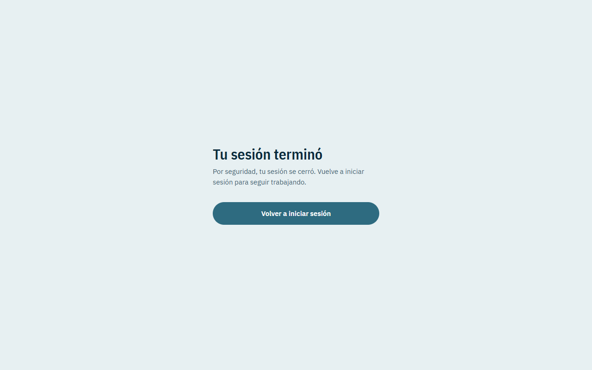

Captura: pantalla «Tu sesión terminó».

### La cuenta está desactivada

Al intentar entrar aparece **Esta cuenta está desactivada. Pide a la coordinación que la active.** Escriba a la coordinación para que la reactive.

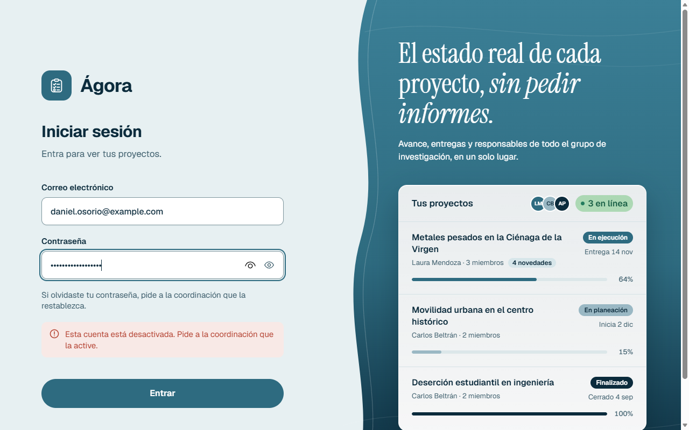

Captura: entrada con una cuenta desactivada.

### El proyecto está en solo lectura

Un proyecto **Finalizado** se puede mirar y descargar, pero no cambiar: desaparecen los botones para editar, crear y borrar. En su chat, el campo está desactivado y dice **Este proyecto está cerrado. La conversación es de solo lectura.**

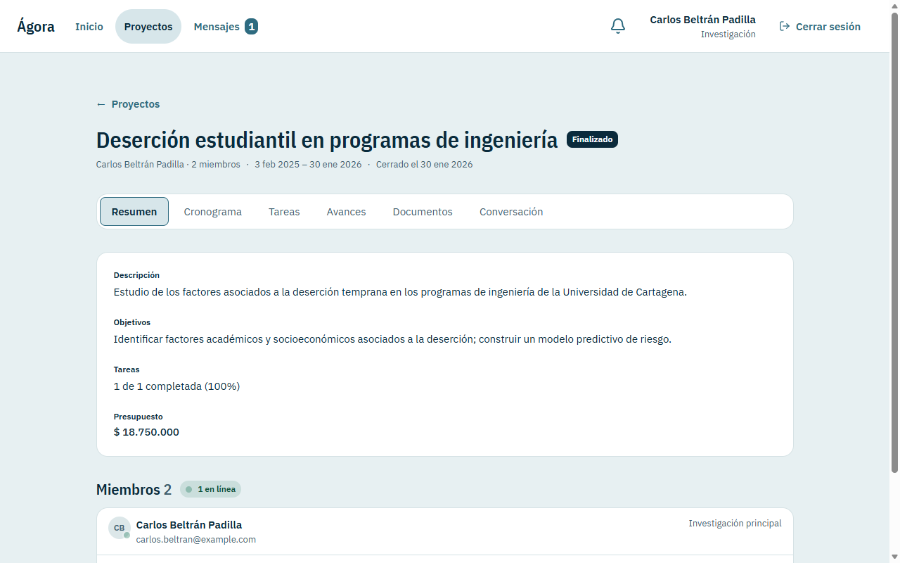

Captura: proyecto finalizado, sin botones de gestión.

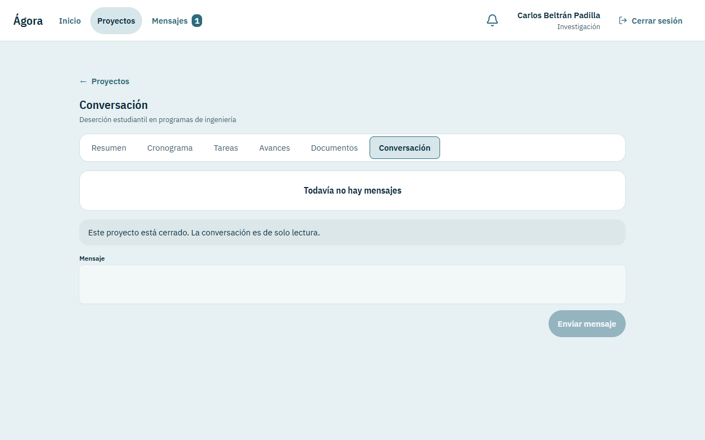

Captura: chat de un proyecto finalizado.

### «Este proyecto no existe o no tienes acceso»

Aparece cuando la dirección del proyecto no existe, o cuando usted no es miembro. Ágora no distingue los dos casos a propósito. Pulse **Volver a proyectos**. Si cree que debería tener acceso, pida a la investigación principal que lo agregue.

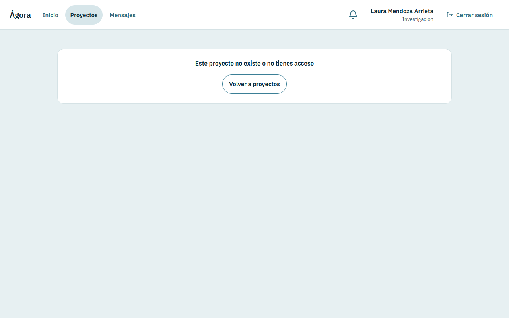

Captura: aviso al abrir un proyecto del que no se es miembro.

### Un archivo de más de 20 MB

Aparece **El archivo no puede superar 20 MB.** y no se sube (sección [5.5](#55-documentos)). Comprima el archivo o súbalo en partes.

### Otros avisos frecuentes

| Aviso | Qué hacer |
| --- | --- |
| **El correo o la contraseña no coinciden. Revísalos e inténtalo de nuevo.** | Revise el correo y la contraseña. Si la olvidó, pídala a la coordinación. |
| **El título es obligatorio.** / **El nombre es obligatorio.** | Complete ese campo. |
| **Elige quién dirige el proyecto.** | Elija la investigación principal. |
| **No hay ninguna cuenta activa con ese correo.** | Revise el correo; pida a la coordinación que cree o reactive la cuenta. |

---

## 12. Usar Ágora desde el celular

En una pantalla angosta (celular), la barra de arriba se reemplaza por una **barra inferior** con cinco botones:

| Botón | Para qué sirve |
| --- | --- |
| **Inicio** | Su inicio. |
| **Proyectos** | La lista de proyectos. |
| **Chat** | Sus conversaciones privadas (**Mensajes**). |
| **Avisos** | Las notificaciones. Se abren a pantalla completa; **Cerrar** vuelve. |
| **Cuenta** | Abre un panel con su nombre, su rol y **Cerrar sesión**. |

La coordinación no tiene **Reportes** ni **Cuentas** en la barra: los abre con los botones **Ver reportes** y **Cuentas** del Inicio.

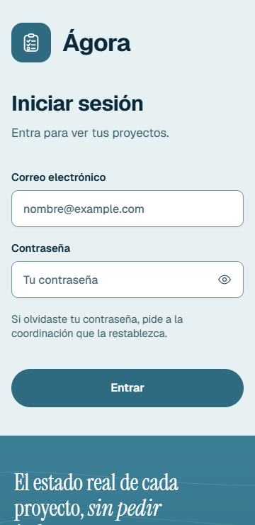

Captura: entrada en un celular de 360 píxeles de ancho.

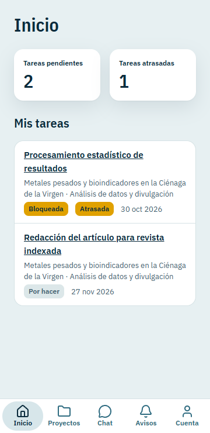

Captura: Inicio de Laura Mendoza en el celular.

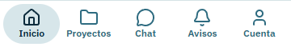

Captura: la barra inferior.

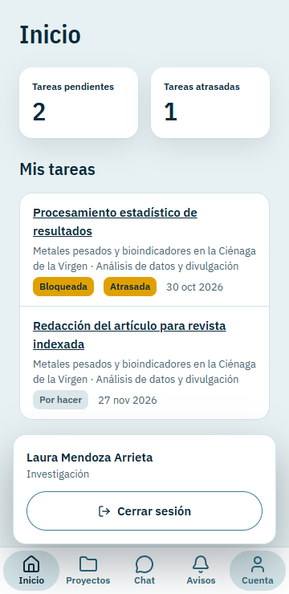

Captura: panel **Cuenta**, con **Cerrar sesión**.

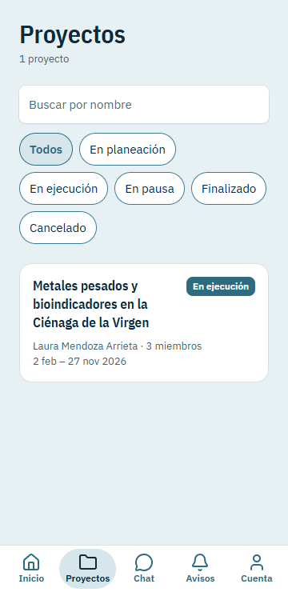

Captura: lista de proyectos en el celular; los filtros pasan a varias filas.

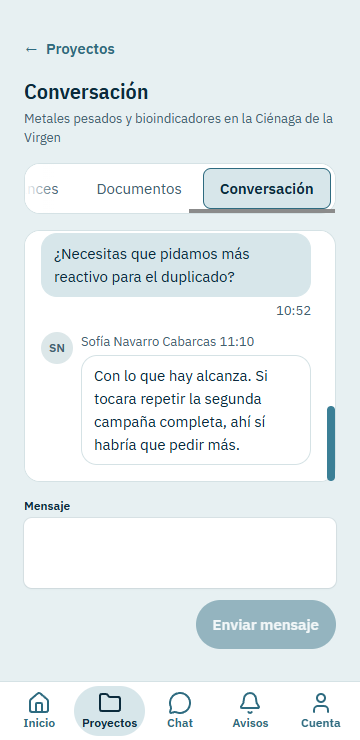

Captura: chat del proyecto en el celular. Las pestañas del proyecto se deslizan hacia los lados.

En el celular, los botones de cada fila (editar, borrar…) pasan debajo del texto.

---

## 13. Recorrido de demostración con dos cuentas

Sirve para mostrar Ágora en vivo. Necesita dos cuentas: la de **Laura Mendoza** (investigación principal) y la de **Andrés Pardo** (coinvestigación); sus datos están en la sección [1.5](#15-cuentas-de-prueba).

**Antes de empezar.** Abra dos pestañas nuevas del navegador (no duplique una pestaña): cada pestaña guarda su propia sesión. Ponga una a cada lado de la pantalla. Entre con Laura en una y con Andrés en la otra.

1. **Presencia.** En ambas pestañas abra el proyecto de metales pesados. En **Miembros** se ve **2 en línea**.
2. **Chat en vivo.** Abra **Conversación** en las dos. Escriba un mensaje como Andrés: aparece en la pantalla de Laura sin recargar.
3. **Notificación en vivo.** Con Laura, vaya a **Tareas**, pulse **Editar** en «Redacción del artículo para revista indexada», elija a Andrés en **Responsable** y pulse **Guardar cambios**. En la pestaña de Andrés, la campana suma un aviso: **Se te asignó una tarea**. Pulse **Ver**.
4. **Estado de una tarea en vivo.** Con Andrés, en **Tareas**, cambie el estado de «Campaña de muestreo — temporada de lluvias» a **En revisión**. La pantalla de Laura lo muestra sin recargar.
5. **Avance en vivo.** Con Laura, en **Avances**, pulse **Registrar avance**, escriba un texto y pulse **Registrar avance**. Aparece en la pantalla de Andrés.
6. **Mensaje privado.** Con Laura, en **Resumen**, pulse **Escribir** junto a Andrés y envíe un mensaje. En la pantalla de Andrés, **Mensajes** muestra un número de no leídos.
7. **Cuentas (coordinación).** Cierre sesión y entre con la coordinación: en **Cuentas**, cree una cuenta, muestre la contraseña que aparece una sola vez y restablézcala.

**Consejos para la demostración.**

- Deje las dos pestañas visibles a la vez: lo que se ve en vivo es lo que más impresiona.
- Antes de empezar, cierre los cuadros abiertos y vuelva al Inicio.
- Si un aviso tarda, espere unos segundos antes de recargar.
- Cuando muestre la contraseña generada, tenga la ventana lista para copiarla: no se vuelve a mostrar.
- Para repetir la demostración desde cero, pida que se vuelva a cargar el seed (los datos de prueba).
